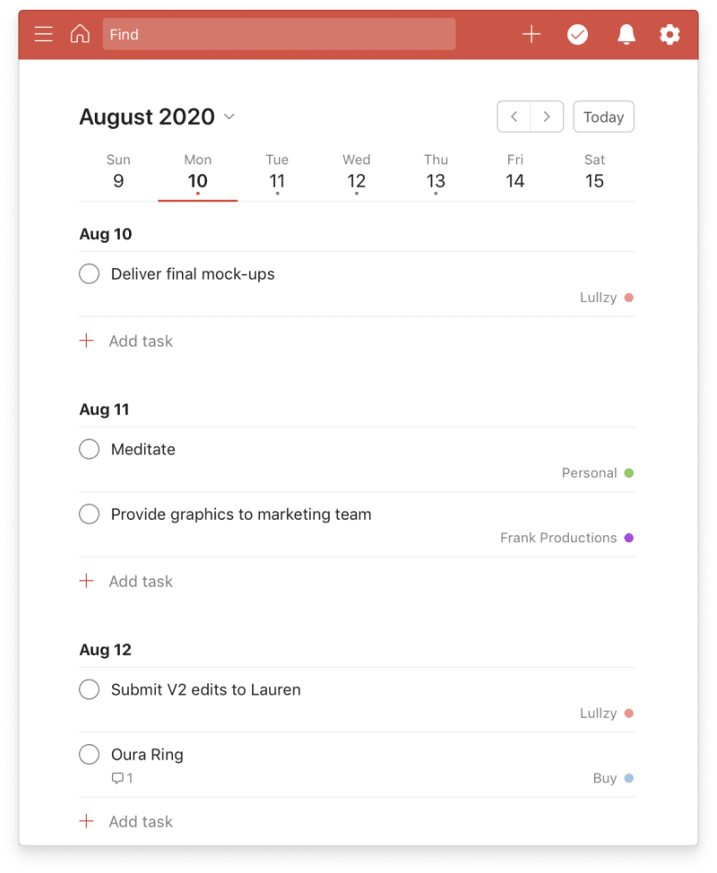
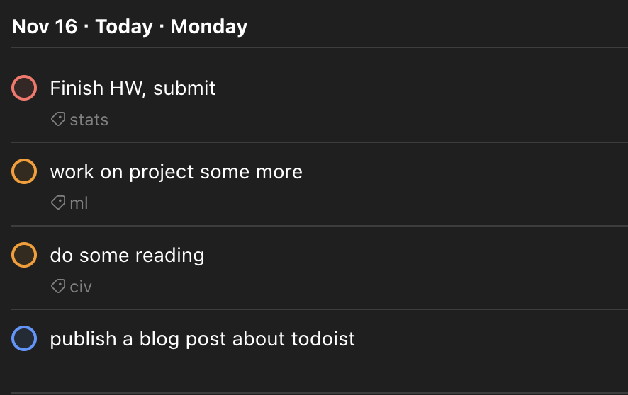

I'd like to consider myself a pretty organized guy, but I really don't use my calendar that much. In fact, other than for meeting links or large events, I tend not to look at my calendar at all. A few days ago I thought this might've specifically been because some shortcomings of Google Calendar, so I trialed Fantastical Premium, but still didn't find it to be that useful.

Then I realized that I don't use calendars more because all the other functionality I *could* get out of them I already get out of Todoist, with a very simple but efficient system that I think is hard to beat with a calendar. Here's the basic rundown.

The only view I ever use in Todoist is the "Upcoming" view, which lists all overdue tasks, then tasks for today, then tomorrow, and so on and so forth. Here's an image of what it looks like from [some random Todoist guide](https://www.todoist.com/inspiration/todoist-guide-freelancers):

{style="width:90%; margin: 0 auto;"}

Apart from just writing the todo name, I only use three "special features" of Todoist: natural language input, tags, and priorities (all the other featuers I find either too clunky or unintuitive). 

Natural language input is simple: You Can Just Type Things and Todoist will recognize what you mean. For example, Todoist parses `tom p1 @stats Finish HW, submit` as a todo for tomorrow, priority 1, tagged as "stats," with the actual todo being "Finish HW, submit." When you're inputting tasks, you basically never have to use your trackpad! 

Tags are also simple, I just use them to list what project/class the task is for. Normally I *don't* go for features like this---they often require selecting from a dropdown which is usually very slow---but being able to assign them with natural language makes it super convenient.

Finally, priorities are *technically* supposed to be to demarcate how high-priority an item is (duh), but I don't use them for that. Instead, because I don't like Todoist's deadline feature,[^deadline] I use them to represent *when* in the day I should do a task. As an example:

{style="width:90%; margin: 0 auto;"}

The above day would consist of:
- finishing and submitting my stats homework in the morning;
- working on my ML project and doing some reading for a civilizations class in the afternoong; and
- publishing a blog post about Todoist at night.

So that's the entire way I use Todoist. There are two main downsides: 1) this system doesn't work great for things like non-repeating events with fixed times, so that's one use I still get out of calendars; 2) there's no way to specify the order with which to complete tasks that take place inside the same working block, though I've never found this to be a problem personally.

P.S. [Dynomight title.](https://dynomight.net/lists/)

[^deadline]: Why, when I put a todo in for 4:30 PM, should the todo's deadline time become a bright red the moment it turns 4:30 PM, as if that task was supposed to be *done* by 4:30? Who's to say I couldn't have planned to *start* the task at 4:30? And so why not hit pause on the harsh, judgmental red---almost as if I were receiving a failing grade delivered in a bright red marker on my "Start laundry" todo---until ~30 minutes after that actual time? Well, the reason is obvious: because "~30 minutes" is just an arbitrary amount of time, and any amount of time other than the time I myself originally typed in will similarly be somewhat arbitrary. This whole problem is theoretically solved by Todoist premium's "task duration" feature, but *separately* from this whole judgmental-red saga, I have larger issues with setting strict times for fluid tasks. Anyway.
